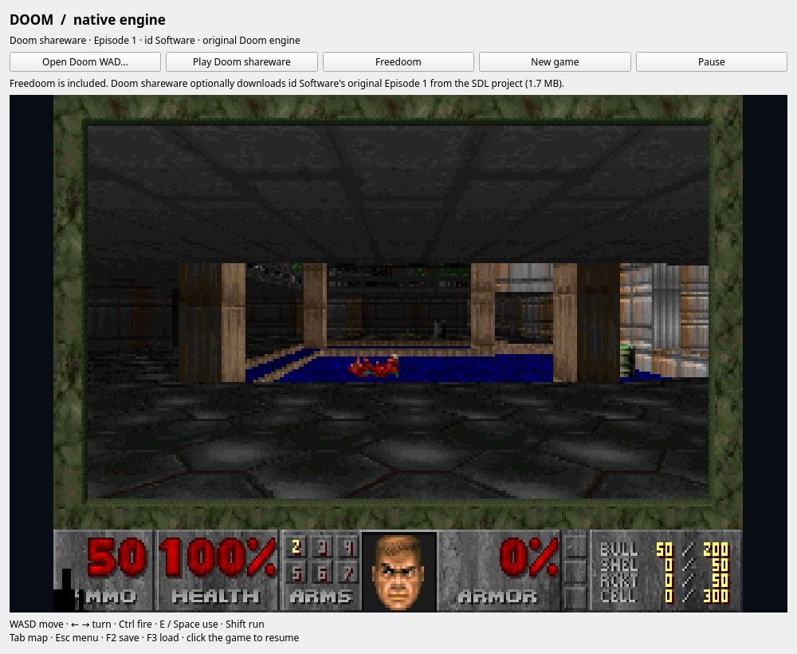
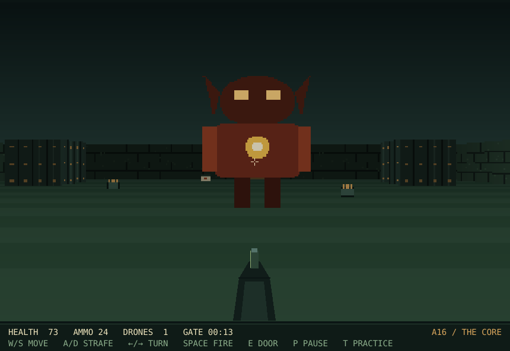
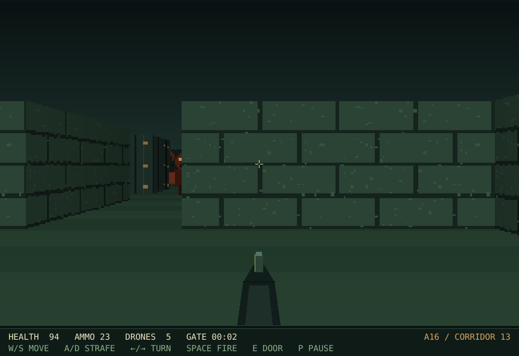
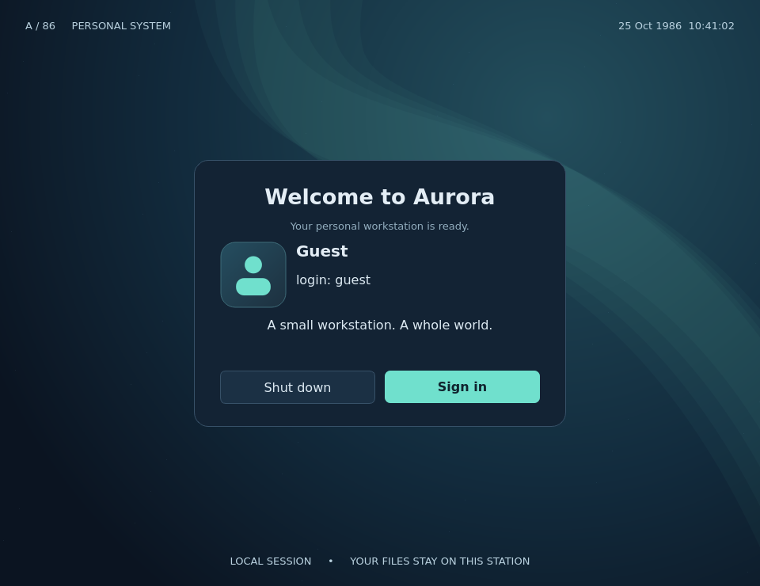
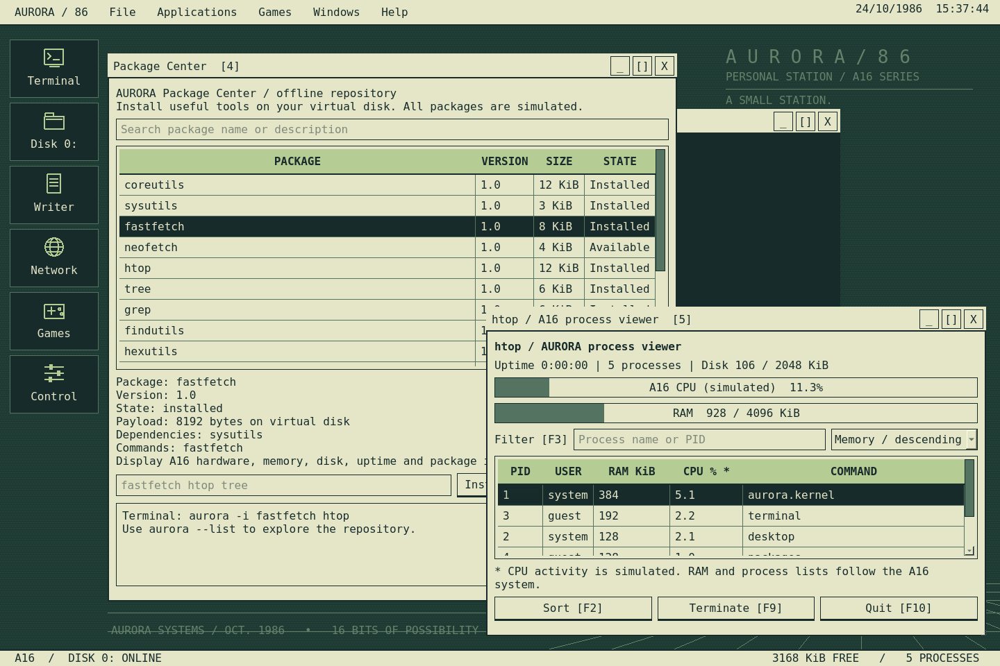
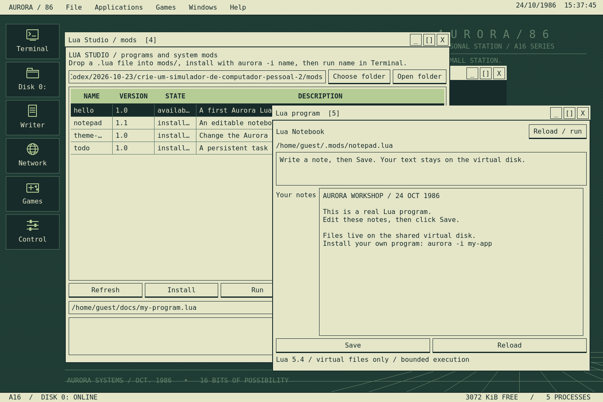

# AURORA/86 1.6.0

[Português](README.pt-BR.md) · [Downloads](https://github.com/fis4med2/Aurora86/releases) · [Ideas roadmap (PT-BR)](ROADMAP.pt-BR.md)

A fictional 1986 personal computer, built in **C++20 and Qt 6**. AURORA has its own boot sequence, desktop, Unix-inspired shell, shared virtual disk, package manager, Lua runtime and native applications. The interface is in English.


## What's new in 1.6

- Redesigned midnight desktop, procedural aurora wallpaper, clearer windows and a searchable application launcher (**Ctrl+Space**).
- **System Center:** live memory history, processes, persistent services and event log. Try systemctl, journalctl, hostnamectl, find and du in the terminal.
- File Manager adds places, filtering, navigation history and virtual-disk copy/paste. The browser preserves the original colors of websites.
- **Real Doom engine inside the workstation:** Freedoom: Phase 1 is included; use **Open Doom WAD…** to load your own Doom or Doom II IWAD. WASD / arrows move, Ctrl fires, E / Space uses, F2 saves and F3 loads. **Get Doom shareware** downloads the original first episode from the SDL project over HTTPS with pinned checksums; original game data is kept outside the source and AppImage. Sound effects work; MIDI music is not included. Saves stay on the host, outside the 2 MiB virtual disk. [Engine and free data credits](third_party/doom/UPSTREAM.txt).



## What's new in 1.5

- **HELLGATE grows into a campaign:** after corridor 13 the station opens **THE CORE**, a ring corridor around the Warden's arena. Four gates lead in, the Warden shoots back, and the last portal only opens once it falls.
- **Practice mode (`T`):** drones and the Warden hold their fire so you can learn the map, marked on the HUD.
- **Projectiles and sector records:** energy bolts with their own sprite and collision, plus best times kept per sector and for the whole run.
- **Eleven regression cases** now drive both maps with real key events, including the boss fight and the sealed final gate.



## What's new in 1.4

- **HELLGATE / corridor 13:** the station's first first-person game. A textured raycaster drawn by the simulated A16 itself — walls, floor and ceiling column by column, nine rooms, gates that open with `E`, five drones with billboard sprites, health and ammo pickups, and a timer that keeps your best crossing.
- **No new dependencies:** every wall, drone and gate texture is generated in code at start-up, so the 1986 illusion holds and the virtual disk stays at 2048 KiB.
- **Documentation and tests:** a HELLGATE page in the station handbook, a new keyboard reference, and seven regression cases covering the map, the renderer, collisions, ammo and gates.



## What's new in 1.3

- **A16 BASIC:** the terminal is now a BASIC interpreter. Numbered lines, `FOR/NEXT`, `IF/THEN/ELSE`, `GOSUB/RETURN`, `DIM`, `DATA/READ`, strings, `SAVE`/`LOAD`, and hard limits so a runaway loop can never freeze the station.
- **A real ASTER shell:** pipes (`ls | grep txt`), sequences (`;`, `&&`), variables (`$HOME`, `$USER`, `$?`), `export`, `alias`, `history`, `which` and wildcards (`*.txt`, `docs/*`).
- **Live `/proc`:** `cpuinfo`, `meminfo`, `uptime`, `version` and `loadavg` mirror the simulated machine and compose with pipes.
- **A16 printer:** `lpr`, `lpq` and `lprm`, with an 80-column continuous-paper queue on the virtual disk.
- **A16ARC:** `pack`, `unpack` and `arc -l`, compressed, for moving files between disks.
- **Interface:** a window taskbar in the footer, a starfield screen saver, **PrtSc** screen capture, the **F1** station handbook and a **Shift+F1** keyboard reference.
- **Old states keep working:** 1.2 state is migrated automatically (`/proc` is created on first open).






## Run

Download the executable from [Releases](https://github.com/fis4med2/Aurora86/releases). The Linux AppImage is **x86_64 and requires glibc 2.44 or newer**, an X11/Wayland session and host graphics drivers. Qt, WebEngine/Chromium, fonts and audio libraries are included. Older distributions need a rebuild against an older baseline.

```sh
chmod +x AURORA86-x86_64.AppImage
./AURORA86-x86_64.AppImage
```

Without FUSE:

```sh
./AURORA86-x86_64.AppImage --appimage-extract-and-run
```

Windows can be built from source with `packaging/windows/package.ps1`. The Windows installer has not been validated for this release.\n\nFirst login: **Guest, no password → Sign in**. Enter/Space skips boot. **F11** toggles fullscreen. Drag window title bars to move them and resize from the bottom-right corner. The Windows menu restores minimized applications. **F1** opens the station handbook with keyboard, terminal, BASIC and Lua guides, and **Shift+F1** shows the keyboard reference card.

For wallpaper, use **AURORA / 86 → Wallpaper...** or right-click the desktop. Display presets, text size, themes, audio and clock live in **AURORA / 86 → Control Panel**. The auroraSYNC profile is under **AURORA / 86 → auroraSYNC profile...**. Imported images are copied into the virtual disk; the original Linux file is unchanged.

## Applications

- **ASTER terminal:** `help`, `ls -l`, `cd`, `pwd`, `cat`, `echo` with `>`/`>>`, `mkdir`, `touch`, `rm -r`, `mv`, `cp`, `chmod`, `stat`, `df`, `free`, `ps`, `kill`, `date`, `uname`, `whoami`, `clear`. Quoted paths, history and Tab completion. Games open with `prism`, `garden`, `eco`, `snake`, `blocks` or `games`. `exit` closes the terminal; `shutdown` closes the simulator.
- **Disk 0:** create, open, delete and move/rename virtual files and directories.
- **Writer:** UTF-8 editor with Ctrl+S and unsaved-change/overwrite prompts.
- **Control Panel, calculator, image viewer and system monitor.**
- **Station handbook:** F1 opens the built-in manual with keyboard, terminal, HELLGATE, BASIC and Lua guides.
- **Package Center:** browse, search, install and remove the offline packages.
- **Lua Studio:** list, run, edit, install and remove Lua programs.
- **Network Mail:** real HTTP/HTTPS browsing through Chromium, navigation controls and HTML saving to the virtual disk. Browser file access, uploads, host downloads and device permissions are disabled. Chromium sandboxing stays enabled.

## A16 BASIC

Type `basic` in the terminal. The prompt becomes `basic>` and AURORA behaves like a 1986 micro:

```text
basic> 10 PRINT "AURORA/86"
basic> 20 FOR I = 1 TO 4
basic> 30 PRINT I; " SQUARED IS "; I * I
basic> 40 NEXT I
basic> RUN
```

Commands: `RUN`, `LIST [range]`, `NEW`, `SAVE "NAME.BAS"`, `LOAD "NAME.BAS"`, `SYSTEM` (back to ASTER).
Statements: `PRINT` with `;` and `,`, `LET`, `INPUT`, `IF/THEN/ELSE`, `GOTO`, `GOSUB`/`RETURN`, `FOR`/`NEXT`/`STEP`, `DIM` (up to two dimensions), `DATA`/`READ`/`RESTORE`, `REM`, `END`, `STOP`, `CLS`, `BEEP`, `RANDOMIZE`.
Functions: `ABS`, `SGN`, `INT`, `SQR`, `SIN`, `COS`, `TAN`, `ATN`, `EXP`, `LOG`, `RND`, `LEN`, `VAL`, `ASC`, `CHR$`, `STR$`, `LEFT$`, `RIGHT$`, `MID$`, `SPACE$`, `STRING$`, `HEX$`, `OCT$`.

A sample program ships at `/home/guest/docs/welcome.bas` (`basic docs/welcome.bas`, then `RUN`). The limits are real: 64 KiB of output, 250,000 instructions per run, 2,000 lines and arrays up to 4,096 elements. Errors use the classic format with the line number (`?SYNTAX ERROR IN 30`).

## Printer, archives and `/proc`

```text
lpr docs/journal.txt      queue a job
lpq                       list the queue
lprm all                  empty the queue

pack backup.arc docs/*.txt
arc -l backup.arc
unpack backup.arc copy

cat /proc/meminfo | grep MemFree
cat /proc/cpuinfo
```

The print queue lives in `/tmp/print`, with an 80-column header per job. A16ARC files are compressed and reject path names, too many members or expansion above 512 KiB. `/proc` is generated from the real state of the simulated machine: memory, processes, uptime and version.

## Interface

The footer now carries a **window taskbar**: click a title to restore and focus. The screen saver starts after five idle minutes (Control Panel → Display, or turn it off) and any key returns; **PrtSc** saves a PNG to `/home/guest/images/snap-NNNN.png` and opens it in Atelier; **F1** opens the station handbook and **Shift+F1** the keyboard reference.

## Packages

The catalog is offline and uses the virtual disk. These are simulated tools with virtual files and processes, not host programs.

```text
aurora --list
aurora -i fastfetch htop tree grep coreutils manuals
fastfetch
htop
man grep
aurora -l
```

Other tools include neofetch, cowsay, figlet, cal, nano and less. `aurora -s TEXT` searches, `aurora --info NAME` shows details and `aurora -r NAME` removes a package after checking dependencies. htop shows live simulated processes with F2/F3/F9/F10 controls.

## Lua programs and mods

Open **Lua Studio** from Applications or enter `mods`. Its `mods/` folder is created automatically when possible; **Choose folder** selects another host folder. Drop a UTF-8 `.lua` file there, then install and run it:

```text
aurora -i hello
hello
```

Examples live in [`mods/`](mods/): `hello`, `notepad` and `theme-switcher`. Installation copies scripts into the virtual disk. Lua Studio can also run, edit or remove installed programs. Run a virtual file directly with `lua /home/guest/docs/program.lua`.

Save this as `my-app.lua`; install with `aurora -i my-app`, then run `my-app`:

```lua
-- @name my-app
local n = 0
aurora.window {
    title = "My program", text = "Click a button",
    buttons = {
        {label = "Count", action = function()
            n = n + 1
            aurora.text("Count: " .. n)
        end},
        {label = "Reset", action = function()
            n = 0
            aurora.text("Count: 0")
        end}
    }
}
```

Lua API: `aurora.read/write/list/mkdir` and `aurora.theme/setting`. Limits: **1 MiB heap**, an instruction budget and **64 KiB output**. There is no host io/os, native module or code loader; some functions are restricted. Mods are portable and need no DLLs. Changes to the C++ core require an SDK and a rebuild.

## Games

| Game | How to play |
| --- | --- |
| Prism | Rotate mirrors to route a laser to its receiver. Six levels; puzzle state persists. |
| Orbital Garden | Plan cross-shaped watering moves to restore an orbital garden. Eight puzzles; progress persists. |
| Echo | Watch and listen, then repeat the pad sequence using mouse or keyboard. Persistent best score. |
| Circuit | Route a growing signal using arrows/WASD without crossing its trail. Space pauses; Enter restarts. |
| Orbital Watch | Move with arrows/WASD and shoot with Space. P pauses; Enter restarts. Three shields and persistent best score. |
| HELLGATE | First-person campaign: `WASD` move, `Shift` runs, arrows turn, `Space` fires, `E` opens gates, `P` pauses, `T` practice, `R` restarts. Clear corridor 13, then break into the core and retire the Warden; best times persist per sector. |

## Persistence and boundaries

The A16 models 8 MHz, **4096 KiB simulated RAM** and a **2048 KiB virtual disk**. Virtual files, permissions, settings, the auroraSYNC profile, installed packages and mods, imported wallpaper and game progress are stored atomically in `vfs.json` under `~/.local/share/Aurora/AURORA86/` or the corresponding XDG data directory. `--state-dir PATH` selects a separate computer. Existing 1.1 states remain usable.

`/bin`, `/sys` and `/etc` are protected; `/home/guest` and `/tmp` are writable. Virtual paths never become Linux paths, and the shell and Lua do not execute host commands. The wallpaper picker is an explicit, read-only import bridge. The clock is simulated. Invalid state is preserved rather than overwritten, and a lock prevents two sessions from writing to the same disk.

This is an interactive environment simulator, not CPU instruction emulation or a complete Unix. RAM quotas are simulated; actual Chromium memory use depends on websites. Browser sessions stay in memory, DRM is not bundled, and some sites may need capabilities that are disabled. Active arcade rounds restart; puzzle progress and best scores persist.

## Build and test

Requires CMake ≥3.21, a C++20 compiler and Qt ≥6.8 with Core, Widgets, Network and Test. Multimedia and WebEngineWidgets are optional: when they are missing, CMake still builds the station with a silent sound layer and an offline Network window instead of Chromium. The Lua source is included in `third_party/`.

```sh
cmake -S . -B work/build -DCMAKE_BUILD_TYPE=Release
cmake --build work/build -j4
QT_QPA_PLATFORM=offscreen ctest --test-dir work/build --output-on-failure
./work/build/aurora86
bash packaging/build-appimage.sh
```

The AppImage script also uses Python 3, curl, ldd and readelf. Official AppImage tools are downloaded with pinned SHA-256 hashes. Host glibc and graphics drivers remain external; the script records compatibility in `COMPATIBILIDADE.txt`. Rebuild dependencies on an older distribution for a wider baseline.

`--self-test` checks applications without network access. `--browser-check https://example.com` checks real Chromium navigation. `AURORA_NO_AUDIO=1` disables audio; offscreen tests do this automatically. Wallpaper imports are reduced to at most 960×640 and respect virtual disk capacity.

Core files live in `src/`, regression tests in `tests/`, and distribution metadata/scripts in `packaging/`. Main downloads and screenshots are also placed directly in the project folder. AppImages are release assets rather than Git objects because they exceed GitHub's normal file size limit.

## License

Project code is **GPL-3.0-or-later**. Lua is MIT. Third-party libraries and fonts keep their own licenses; font licenses are in `assets/`, and dependency notices are under `usr/share/licenses` in the extracted AppImage.
