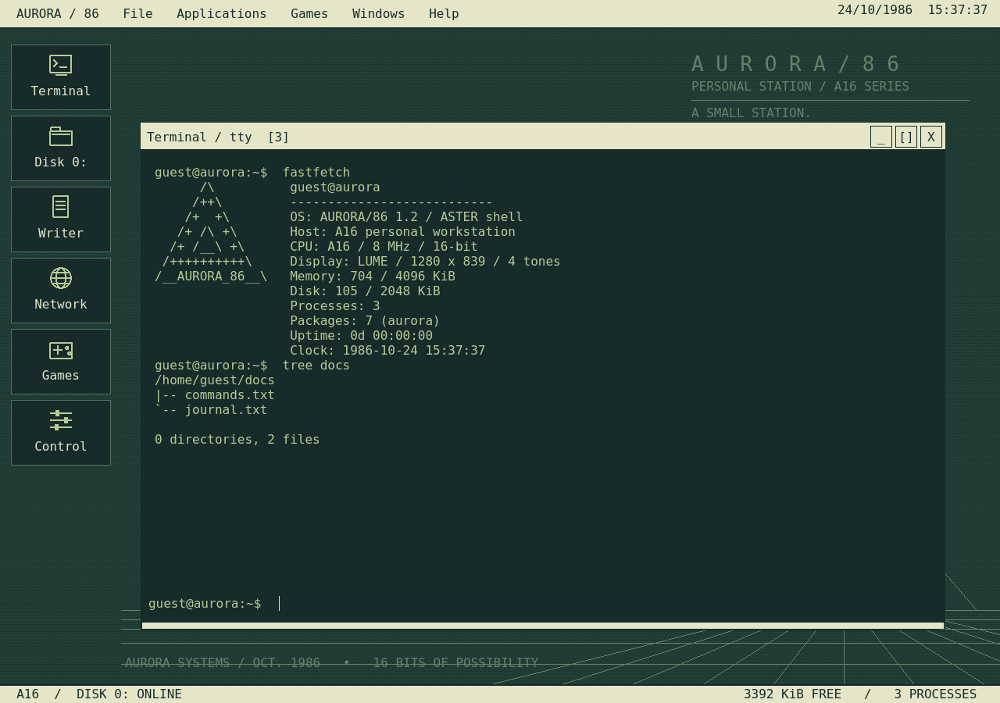
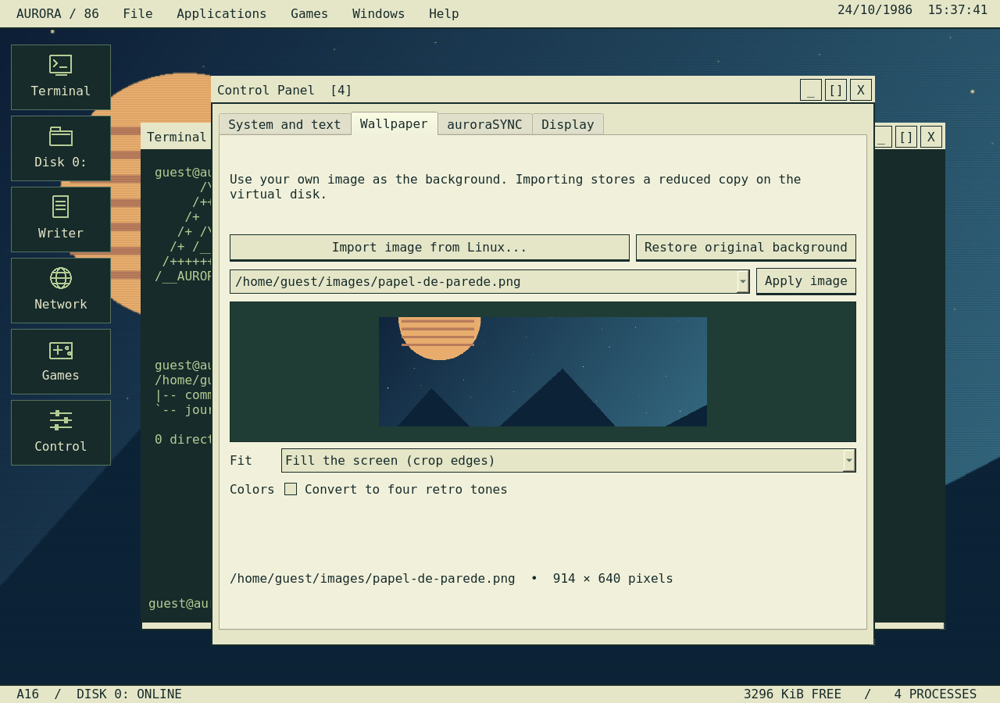
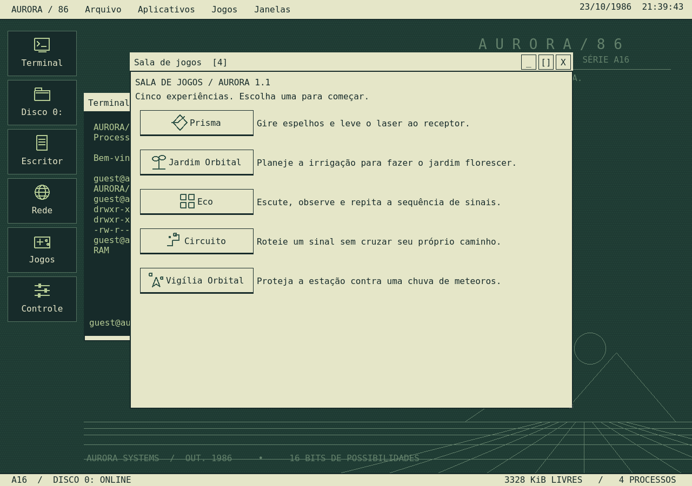
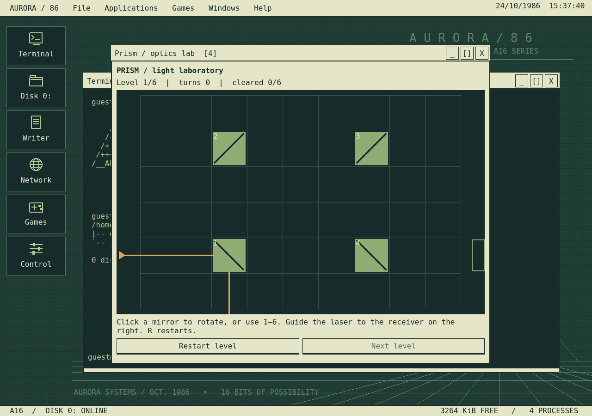

# AURORA/86 1.2.0

[English](README.md) · [Downloads](https://github.com/fis4med2/Aurora86/releases) · [Roadmap de ideias](ROADMAP.pt-BR.md)

Computador pessoal fictício de 1986, escrito em **C++20 e Qt 6**. O AURORA tem boot próprio, desktop, terminal inspirado no Unix, disco virtual compartilhado, gerenciador de pacotes, runtime Lua e aplicativos nativos. A interface está em inglês.



## Novidades da versão 1.2

- **Interface em inglês:** menus, aplicativos, textos de ajuda e arquivos do sistema simulado agora usam inglês.
- **auroraSYNC:** entre como Guest, ajuste nome, login, nota, mensagem, avatar e fundo, defina uma senha opcional e bloqueie a sessão com Ctrl+Alt+L.
- **Pacotes:** repositório offline com 16 pacotes e 23 utilitários, com dependências e espaço simulado em disco. Instale pelo Package Center ou com `aurora`.
- **Lua 5.4.8:** o Lua Studio instala e edita mods portáteis a partir de uma pasta do Linux. Os scripts rodam dentro do computador simulado.
- **Builds para Windows:** o workflow gera um instalador e um ZIP portátil quando a validação terminar.





## Executar

Baixe o executável em [Releases](https://github.com/fis4med2/Aurora86/releases). O AppImage para Linux é **x86_64 e exige glibc 2.44 ou superior**, sessão X11/Wayland e drivers gráficos do Linux. Qt, Chromium/WebEngine, fontes e bibliotecas de áudio estão incluídos. Distribuições antigas precisam de outra compilação sobre uma base mais antiga.

```sh
chmod +x AURORA86-x86_64.AppImage
./AURORA86-x86_64.AppImage
```

Sem FUSE:

```sh
./AURORA86-x86_64.AppImage --appimage-extract-and-run
```

O build para Windows ainda está em validação. Quando o [workflow](.github/workflows/windows.yml) terminar, ele gera dois arquivos:

- `AURORA86-Setup-x64.exe`: instalador para Windows 10/11 x64, sem exigir administrador.
- `AURORA86-Windows-x86_64.zip`: extraia a pasta inteira e abra `aurora86.exe`. Mantenha as DLLs, plugins e recursos juntos.

Primeiro login: **Guest, sem senha → Sign in**. Enter/Espaço pula o boot. **F11** alterna tela cheia. Arraste a barra de título para mover janelas e redimensione pelo canto inferior direito. O menu Windows restaura aplicativos minimizados.

Para trocar o papel de parede, use **AURORA / 86 → Wallpaper...** ou clique com o botão direito no desktop. Presets de tela, tamanho do texto, temas, áudio e relógio ficam em **AURORA / 86 → Control Panel**. O perfil auroraSYNC está em **AURORA / 86 → auroraSYNC profile...**. A importação copia a imagem para o disco virtual e não altera o arquivo original no Linux.

## Aplicativos

- **Terminal ASTER:** `help`, `ls -l`, `cd`, `pwd`, `cat`, `echo` com `>`/`>>`, `mkdir`, `touch`, `rm -r`, `mv`, `cp`, `chmod`, `stat`, `df`, `free`, `ps`, `kill`, `date`, `uname`, `whoami`, `clear`. Aspas, histórico e Tab para completar caminhos. Jogos abrem com `prism`, `garden`, `eco`, `snake`, `blocks` ou `games`. `exit` fecha o terminal; `shutdown` encerra o simulador.
- **Disk 0:** criação, abertura, exclusão e movimentação de arquivos e pastas virtuais.
- **Writer:** edição UTF-8, Ctrl+S e confirmação de alterações não gravadas ou substituição.
- **Control Panel, calculadora, visualizador de imagens e monitor do sistema.**
- **Package Center:** navegar, pesquisar, instalar e remover os pacotes offline.
- **Lua Studio:** listar, executar, editar, instalar e remover programas Lua.
- **Network Mail:** HTTP/HTTPS reais pelo Chromium, navegação e gravação de HTML no disco virtual. Acesso a arquivos locais, uploads, downloads para o Linux e permissões de dispositivos ficam desativados. A proteção do Chromium permanece ativa.

## Pacotes

O catálogo é offline e usa o disco virtual. São ferramentas simuladas, com arquivos e processos virtuais, não programas do Linux.

```text
aurora --list
aurora -i fastfetch htop tree grep coreutils manuals
fastfetch
htop
man grep
aurora -l
```

Outros utilitários incluem neofetch, cowsay, figlet, cal, nano e less. `aurora -s TEXTO` pesquisa, `aurora --info NOME` mostra detalhes e `aurora -r NOME` remove o pacote depois de conferir as dependências. O htop mostra processos simulados com controles F2/F3/F9/F10.

## Programas e mods Lua

Abra o **Lua Studio** em Applications ou digite `mods`. A pasta `mods/` é criada automaticamente quando possível; **Choose folder** escolhe outra pasta do Linux. Coloque nela um `.lua` em UTF-8 e instale:

```text
aurora -i hello
hello
```

Os exemplos ficam em [`mods/`](mods/): `hello`, `notepad` e `theme-switcher`. A instalação copia os scripts para o disco virtual. O Lua Studio também executa, edita e remove programas instalados. Para rodar um arquivo virtual direto, use `lua /home/guest/docs/program.lua`.

Grave como `my-app.lua`, instale com `aurora -i my-app` e execute `my-app`:

```lua
-- @name my-app
local n = 0
aurora.window {
    title = "My program", text = "Click a button",
    buttons = {
        {label = "Count", action = function()
            n = n + 1
            aurora.text("Count: " .. n)
        end},
        {label = "Reset", action = function()
            n = 0
            aurora.text("Count: 0")
        end}
    }
}
```

API Lua: `aurora.read/write/list/mkdir` e `aurora.theme/setting`. Limites: **heap de 1 MiB**, orçamento de instruções e **saída de 64 KiB**. Não há io/os do Linux, módulos nativos ou carregador de código; algumas funções são restritas. Mods são portáteis e não precisam de DLLs. Mudanças no núcleo C++ exigem SDK e recompilação.

## Jogos

| Jogo | Como jogar |
| --- | --- |
| Prism | Gire espelhos para levar o laser ao receptor. Seis níveis; estado do puzzle salvo. |
| Orbital Garden | Planeje movimentos de irrigação em cruz para restaurar o jardim. Oito puzzles; progresso salvo. |
| Echo | Observe, escute e repita a sequência nos botões com mouse ou teclado. Recorde persistente. |
| Circuit | Setas/WASD roteiam um sinal crescente sem cruzar o próprio caminho. Espaço pausa; Enter reinicia. |
| Orbital Watch | Setas/WASD movem e Espaço atira. P pausa; Enter reinicia. Três escudos e recorde salvo. |

## Persistência e limites

O A16 simula 8 MHz, **4096 KiB de RAM** e **2048 KiB de disco**. Arquivos, permissões, configurações, perfil auroraSYNC, pacotes e mods instalados, papel de parede e progresso dos jogos são gravados atomicamente em `vfs.json`, em `~/.local/share/Aurora/AURORA86/` ou no diretório XDG correspondente. `--state-dir CAMINHO` seleciona outra estação. Estados da versão 1.1 continuam utilizáveis.

`/bin`, `/sys` e `/etc` são protegidos; `/home/guest` e `/tmp` aceitam gravação. Caminhos virtuais não acessam arquivos do Linux, e o terminal e o Lua não executam comandos do host. A seleção de papel de parede é uma ponte explícita de importação, somente leitura. O relógio é simulado. Estado inválido é preservado; uma trava impede gravações simultâneas no mesmo disco.

É um simulador de ambiente, não um emulador de instruções da CPU nem um Unix completo. As quotas de RAM são simuladas; o Chromium consome memória real conforme as páginas. Sessões do navegador ficam em memória, DRM não está incluído e alguns sites dependem de capacidades desativadas. Partidas de ação reiniciam; puzzles e recordes persistem.

## Compilar e testar

Requer CMake ≥3.21, compilador C++20 e Qt ≥6.8 com Core, Widgets, Network, Multimedia, WebEngineWidgets e Test. O código do Lua está incluído em `third_party/`.

```sh
cmake -S . -B work/build -DCMAKE_BUILD_TYPE=Release
cmake --build work/build -j4
QT_QPA_PLATFORM=offscreen ctest --test-dir work/build --output-on-failure
./work/build/aurora86
bash packaging/build-appimage.sh
```

O empacotador usa Python 3, curl, ldd e readelf. Ferramentas oficiais AppImage são baixadas com SHA-256 fixado. glibc e drivers gráficos pertencem ao host; o requisito calculado fica em `COMPATIBILIDADE.txt`. Para ampliar a compatibilidade, reconstrua também as dependências numa distribuição mais antiga.

`--self-test` verifica os aplicativos sem rede. `--browser-check https://example.com` verifica navegação real. `AURORA_NO_AUDIO=1` desativa áudio; testes offscreen fazem isso automaticamente. Imagens importadas são reduzidas até 960×640 e respeitam a capacidade do disco virtual.

Fontes em `src/`, testes em `tests/`, metadados e empacotamento em `packaging/`. Executável e capturas também ficam diretamente na pasta principal. O AppImage é disponibilizado nos assets da release, pois ultrapassa o limite normal de arquivos Git do GitHub.

## Licença

O código do projeto é **GPL-3.0-or-later**. Lua é MIT. Bibliotecas e fontes de terceiros mantêm suas próprias licenças; licenças de fontes em `assets/` e avisos das dependências em `usr/share/licenses` dentro do AppImage extraído.
